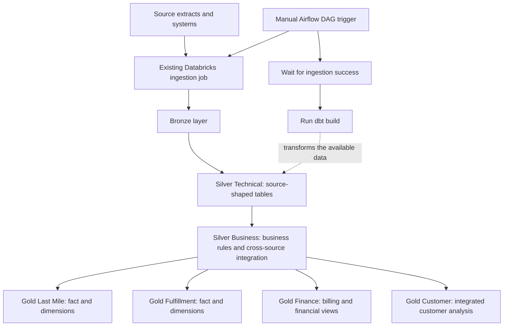

<div align="center">
  <h1>SwiftRoute Logistics Data Platform</h1>
  <p><strong>Turning fragmented logistics, fulfillment, customer, and finance data into decision-ready analytics.</strong></p>
  <p>
    
    
    
    
    
  </p>
</div>


## Table of Contents

- [Project Overview](#project-overview)
- [The Business Problem](#the-business-problem)
- [Business Questions and Analytical Deliverables](#business-questions-and-analytical-deliverables)
- [Architecture and Data Flow](#architecture-and-data-flow)
- [Data Sources](#data-sources)
- [Data Modeling](#data-modeling)
- [Gold Layer Deliverables](#gold-layer-deliverables)
- [Data Quality and Reconciliation](#data-quality-and-reconciliation)
- [Orchestration with Airflow](#orchestration-with-airflow)
- [Technology Stack](#technology-stack)
- [Repository Structure](#repository-structure)
- [Getting Started](#getting-started)
- [Running the Pipeline](#running-the-pipeline)
- [Security and Configuration Notes](#security-and-configuration-notes)
- [Scope and Limitations](#scope-and-limitations)

## Project Overview

SwiftRoute Logistics is a case-study regional logistics business operating last-mile delivery and e-commerce fulfillment services across Denver, Salt Lake City, and Albuquerque. Its operational environment includes delivery management, warehouse and inventory processes, customer and contract management, fleet telemetry, payroll, and finance.

This project builds a data platform that brings the relevant data from those separate systems into a governed transformation workflow. Databricks handles ingestion and data storage, dbt applies technical standardization and business logic, and Apache Airflow orchestrates the existing ingestion job followed by the dbt build.

The outcome is a set of analytics-ready models organized around operational performance, fulfillment activity, finance, and customer economics. The aim is not simply to move data between systems. It is to give analysts and decision-makers a consistent foundation for asking cross-functional business questions without repeatedly assembling data by hand.

> **Project context:** SwiftRoute is represented through a simulated portfolio environment and source extracts. This repository demonstrates a data engineering implementation, not a live production integration with a real logistics company.

## The Business Problem

SwiftRoute's systems each describe a different part of the business. Onfleet records delivery work and outcomes. Linnworks manages fulfillment orders and inventory. Salesforce stores customer and contract information. Samsara provides fleet data. QuickBooks records invoices, payments, and expenses, while Gusto contains employee and payroll information.

When these systems are analyzed independently, each team can see part of the picture, but cross-functional questions require the data to be assembled and interpreted consistently. The business operating context specifically identifies system fragmentation as a source of manual effort and potential error. Examples include connecting delivery activity to contracted pricing, reconciling billed services, understanding receivables, and examining customer economics across operational and financial records.

The engineering challenge is therefore twofold:

1. **Create a dependable technical foundation.** Ingest source data, standardize structures and types, handle source-specific irregularities, and test important assumptions about record grain and relationships.
2. **Turn the foundation into useful business datasets.** Apply business rules, connect related records across systems, and publish clear models that support operational and financial analysis.

## Business Questions and Analytical Deliverables

The Gold models are designed to support questions such as the following. They provide analysis-ready datasets; this repository does not include a separate BI dashboard or reporting front end.

| Business area | Questions the data can support | Relevant deliverables |
|---|---|---|
| **Last-mile operations** | How do delivery outcomes vary by city, service, zone, driver, or customer? Where should an operations review investigate delivery failures or differences in performance? | `fact_delivery` with delivery, customer, driver, service, zone, city, contract, and date dimensions. |
| **Fulfillment operations** | What fulfillment activity is recorded across customers, contracts, products, warehouses, and time? How can fulfillment transactions be analyzed using consistent business keys and dates? | `fact_fulfillment_transaction` and its supporting dimensions. |
| **Billing and revenue assurance** | Do invoice lines reconcile to the source accounting records? Are billing variances visible for follow-up? Are line-level amounts and references preserved? | `billing_invoice_lines`, `billing_reconciliation`, and related financial models. |
| **Cash collection and receivables** | What balances remain outstanding, what payments were received, and how do invoice and payment records relate? | `accounts_receivable` and `financial_transaction_lines`. |
| **Monthly financial reporting** | How do recorded financial transactions and expenses roll up by reporting period? Are collections kept distinct from revenue and expenses in reporting logic? | `financial_reporting_monthly`, supported by transaction-level finance data and reconciliation tests. |
| **Customer economics** | How can customer-level operating activity and financial outcomes be examined together across a period? Which relationships merit deeper investigation? | `silver_business_customer_period_integrated`, `dim_customer_c`, and `fact_customer_economics`. |

These are intended analytical questions, not claims that the repository already contains dashboards or that every possible KPI is implemented. A model's actual usable measures and grain should be confirmed from its SQL and properties files before a metric is published to business users.

## Architecture and Data Flow

The platform separates ingestion, technical preparation, business transformation, and analytics-facing outputs. This separation keeps source-specific cleanup from becoming tangled with business definitions, while allowing the Gold models to be organized around how the business operates and evaluates performance.

### End-to-end data flow



### Bronze: source ingestion

The Bronze layer is populated by the existing Databricks ingestion job. That job executes the loader process and lands the source data in the Databricks environment. Airflow does not run the repository's local loader scripts directly; it triggers the Databricks job and waits for its outcome before continuing.

The `loaders/` and `source_data/` folders remain in the repository as implementation context and reproducibility references. The actual remote job configuration, source locations, permissions, and workspace resources must still exist in the Databricks environment.

### Silver Technical: source-aligned preparation

Models under `silver_t/` are designed to prepare standardized, typed, source-shaped tables. This layer addresses technical requirements such as handling nested source structures, normalizing fields, applying data types, preserving expected record grain, and making source data easier to use downstream. Business calculations and cross-system conclusions belong in the next layer instead.

### Silver Business: business rules and integration

Models under `silver_b/` apply business logic and integrate records where the business question requires data from multiple systems. This layer separates operational and financial interpretation from the source-specific shape of each system. It includes last-mile delivery and fulfillment business models, as well as an integrated customer-period model.

### Gold: analytics-facing models

Gold models are grouped into four business domains: last mile, fulfillment, finance, and customer. These models are configured as views, while the Silver Technical and Silver Business models are configured as tables. The intention is to provide clear, reusable datasets for analysts and reporting tools rather than require every analysis to reconstruct joins and business logic from source tables.

## Data Sources

The implemented ingestion and dbt model scope covers the following systems and subject areas.

| Source system | Business role | Source areas represented in the models |
|---|---|---|
| **Onfleet** | Transport and delivery management | Delivery tasks and workers. |
| **Linnworks** | Warehouse, orders, and inventory | Orders, stock items, and stock transactions. |
| **Salesforce** | Customer, sales, and contract management | Accounts, contracts, contract rates, and opportunities. |
| **Samsara** | Fleet and vehicle information | Driver summaries, trips, and vehicles. |
| **QuickBooks Online** | Accounting and finance | Invoices, payments, and expenses. |
| **Gusto** | Employee and payroll information | Employees and payroll compensations. |

Zendesk is described in the supplied business operating context, but it is not part of the current loader and dbt model scope represented in this repository.

## Data Modeling

The dbt project uses separate model folders and schemas to make the purpose of each layer visible in the project structure.

| Layer | dbt model folder | Materialization | Purpose |
|---|---|---|---|
| Silver Technical | `models/silver_t/` | Tables | Standardized, source-aligned records and technical cleanup. |
| Silver Business | `models/silver_b/` | Tables | Business rules, operational interpretation, and cross-source integration. |
| Gold Last Mile | `models/gold_last_mile/` | Views | Delivery facts and the dimensions used to analyze delivery operations. |
| Gold Fulfillment | `models/gold_fulfillment/` | Views | Fulfillment transaction analysis and supporting dimensions. |
| Gold Finance | `models/gold_finance/` | Views | Billing, reconciliation, receivables, financial transactions, and monthly reporting. |
| Gold Customer | `models/gold_customer/` | Views | Customer dimension and customer economics. |

### Modeling principles

- **Keep technical and business transformations distinct.** Source cleanup should not be confused with a business definition or KPI calculation.
- **Make record grain explicit.** Fact models and their tests should make it possible to reason about what one record represents and whether joins preserve that grain.
- **Preserve source meaning.** Financial headers, line-level amounts, payments, and expenses represent different business events. They should not be collapsed into one number without an explicit business rule.
- **Use authoritative sources for their domain.** For example, Salesforce provides customer and contract context, while QuickBooks provides accounting records for invoices, payments, and expenses.
- **Put reusable interpretation downstream.** Business-oriented models should make recurring questions easier to answer without repeating custom joins in every analysis.

## Gold Layer Deliverables

### Gold Last Mile

The last-mile domain supports analysis of delivery task outcomes and related operational attributes. It includes `fact_delivery` and dimensions for city, contract, customer, date, driver, service, and zone. These shared attributes allow delivery records to be grouped and examined consistently across the operational footprint.

### Gold Fulfillment

The fulfillment domain organizes fulfillment transactions around a fact model, `fact_fulfillment_transaction`, with supporting dimensions for contract, customer, date, product, and warehouse. This structure supports analyses of fulfillment activity by the business entities and time periods represented in the source data.

### Gold Finance

The finance domain includes:

- `billing_invoice_lines`: line-level billing records for analysis and reconciliation.
- `billing_reconciliation`: a model for surfacing billing differences that need review.
- `financial_transaction_lines`: a transaction-oriented representation of supported accounting activity.
- `accounts_receivable`: an analysis-ready view of receivables and related payment information.
- `financial_reporting_monthly`: a monthly financial reporting model.

The finance models and tests pay attention to the distinction between amounts invoiced, payments collected, expenses recorded, and values used in monthly reporting. These concepts are related, but they are not interchangeable.

### Gold Customer

The customer domain includes `dim_customer_c` and `fact_customer_economics`. It is supported by the Silver Business customer-period integration model, which provides a place to align relevant customer activity and financial context before presenting customer-oriented analytical outputs.

## Data Quality and Reconciliation

Testing is part of the transformation design, not a separate afterthought. The dbt project includes model-level property files and singular SQL tests for structural and business assertions.

Examples of tested assumptions include:

- Unique keys and expected record grain in receivables, financial transactions, customer periods, and delivery facts.
- Invoice line amounts and expense amounts reconciling to their QuickBooks source records.
- Payment headers and applied payment totals being preserved, with invoice references resolving as expected.
- Billing reconciliation differences being flagged rather than silently hidden.
- Non-negative billing quantities and valid pricing for lines marked as ready for billing.
- Expected financial reporting sign conventions and the exclusion of collections from P&L logic.
- Silver Business and Gold models preserving intended delivery or fulfillment transaction grain.

These tests help detect broken assumptions when the data or transformations change. A successful `dbt build` means the selected resources completed under the configured tests; it is not a guarantee that every possible business metric has been independently validated.

## Orchestration with Airflow

Apache Airflow orchestrates the end-to-end run through the DAG defined in `airflow/dags/swiftroute_pipeline.py`.

The current workflow is **manually triggered and has no recurring schedule configured**. This matches the project requirement to run the pipeline when needed rather than operate it as a continuously scheduled service.

1. **`ingest_bronze`** uses the Airflow connection `databricks_default` to trigger the existing Databricks job `ingest_swiftroute_bronze` and wait for its completion.
2. **`dbt_build`** runs `dbt build` against the dbt project mounted at `/opt/airflow/swiftroute_project`.
3. The explicit dependency `ingest_bronze >> dbt_build` ensures the dbt task runs only after the ingestion task succeeds.

`dbt build` runs the selected dbt resources in dependency order, including applicable models, tests, seeds, and snapshots defined for the project. Airflow receives the task outcome, making the workflow's status visible in the Airflow UI.

## Technology Stack

| Technology | Role in the project |
|---|---|
| **Databricks** | Hosts the ingestion job, Bronze data, and the transformation execution environment. |
| **dbt Core** | Defines, builds, and tests SQL transformation models. |
| **dbt-databricks** | Connects dbt to the Databricks platform. |
| **Apache Airflow** | Orchestrates the Databricks ingestion job followed by the dbt build. |
| **Databricks Airflow provider** | Provides the operator used to trigger and monitor the existing Databricks job. |
| **Docker Compose** | Runs the local Airflow environment and its supporting services. |
| **PostgreSQL** | Stores Airflow metadata. |
| **Redis and CeleryExecutor** | Support distributed task execution in the local Airflow stack. |
| **Python** | Supports the loader scripts and the orchestration configuration. |

The Airflow container is based on `apache/airflow:3.3.2-python3.12`. The custom image installs Airflow 3.3.2, dbt Core, the Databricks adapter, and the required Airflow providers. The root Python project metadata is separate from the Python environment inside the Airflow Docker image.

## Repository Structure

The tree below highlights the parts that matter for understanding and running the project. Generated folders such as `logs/`, `target/`, and `dbt_packages/`, along with individual source JSON files, are intentionally omitted.

```text
Swiftroute_V2/
├── airflow/
│   ├── dags/
│   │   └── swiftroute_pipeline.py       # Manual ingestion and dbt DAG
│   ├── config/                          # Airflow configuration
│   ├── plugins/                         # Optional Airflow plugins
│   ├── swiftroute_project/              # dbt copy mounted into Airflow
│   │   ├── models/
│   │   │   ├── source/
│   │   │   ├── silver_t/
│   │   │   ├── silver_b/
│   │   │   ├── gold_last_mile/
│   │   │   ├── gold_fulfillment/
│   │   │   ├── gold_finance/
│   │   │   └── gold_customer/
│   │   ├── macros/
│   │   ├── snapshots/
│   │   ├── tests/
│   │   ├── seeds/
│   │   └── dbt_project.yml
│   ├── Dockerfile                       # Custom Airflow image and dependencies
│   └── docker-compose.yaml              # Airflow, PostgreSQL, and Redis services
├── images/
│   ├── SwiftRoute Logistics Data Architecture.png
│   └── Databricks Data Pipeline Workflow.png
├── loaders/                             # Source loader scripts kept for reference
├── source_data/                         # Representative source extracts by system
├── swiftroute_project/                   # Root-level dbt project copy
├── main.py
├── pyproject.toml
├── uv.lock
├── .python-version
└── README.md
```

**Note on the two dbt folders:** `swiftroute_project/` at the repository root and `airflow/swiftroute_project/` are separate copies. The Airflow Compose configuration mounts the copy under `airflow/` into the containers. If you edit the root-level project, make sure the changes are also reflected in the copy used by Airflow, or simplify the layout to maintain a single canonical project path in a future revision.

## Getting Started

The following steps describe the local Airflow setup. They assume you have a Databricks workspace, an appropriately configured SQL warehouse, and the existing ingestion job or an equivalent job in your own workspace. Remote Databricks resources are not created by Docker Compose.

### Prerequisites

- Git and Docker Desktop with Docker Compose available.
- A Databricks workspace and permissions to run the ingestion job and query the target catalog.
- A Databricks personal access token or another authentication arrangement supported by your connection configuration.
- Source data, loader configuration, and Bronze tables available to the Databricks job.

### 1. Configure environment variables

Create `airflow/.env` locally. Do not commit this file.

```dotenv
AIRFLOW_UID=50000
AIRFLOW__CORE__FERNET_KEY=<your-generated-fernet-key>
DATABRICKS_TOKEN=<your-databricks-token>
```

Generate a Fernet key using the Airflow image:

```powershell
docker run --rm --entrypoint python apache/airflow:3.3.2-python3.12 -c "from cryptography.fernet import Fernet; print(Fernet.generate_key().decode())"
```

Paste the generated key into `.env`. Use the token associated with the Databricks workspace in which the dbt profile and ingestion job are configured. Keep key-value pairs free of spaces around `=`.

### 2. Configure the dbt profile

In `airflow/swiftroute_project/profiles.yml`, configure the Databricks profile used by `dbt_project.yml`. The token should be read from the environment rather than hard-coded.

```yaml
swiftroute_project:
  outputs:
    dev:
      type: databricks
      catalog: <your_catalog>
      schema: <your_schema>
      host: <your_workspace_host>
      http_path: <your_sql_warehouse_http_path>
      token: "{{ env_var('DATABRICKS_TOKEN') }}"
      threads: 1
  target: dev
```

Replace the catalog, schema, workspace host, and HTTP path placeholders with values appropriate to your Databricks workspace. Do not commit a personal access token or another secret in this file. Apply the same check to the root-level `swiftroute_project/profiles.yml` if that copy will also be pushed to GitHub.

### 3. Configure the Airflow Databricks connection

After starting Airflow, open **Admin → Connections** and create or update this connection:

| Field | Value |
|---|---|
| Connection ID | `databricks_default` |
| Connection type | `Databricks` |
| Host | Your Databricks workspace URL |
| Password | Your Databricks token |

Keep the token in Airflow's connection store and your local `.env`; never put it directly in the DAG source. The `DATABRICKS_TOKEN` environment variable is used by dbt, while `databricks_default` is used by the Airflow Databricks operator.

### 4. Build and start Airflow

Run these commands in PowerShell:

```powershell
cd airflow
docker compose config --quiet
docker compose build
docker compose up airflow-init
docker compose up -d
docker compose ps
```

Wait for PostgreSQL and Redis to become healthy and for the Airflow services to start. The `airflow-init` container exiting with code `0` is expected after its initialization task completes.

### 5. Open the Airflow UI

Visit [http://localhost:8080](http://localhost:8080). In the local development setup, the default login may be `airflow` / `airflow`, depending on the Compose configuration. Do not keep default credentials for a shared or remotely accessible environment.

### 6. Check the dbt connection

Before triggering the full workflow, validate the mounted project and profile from the Airflow worker:

```powershell
docker compose exec airflow-worker dbt debug --project-dir /opt/airflow/swiftroute_project --profiles-dir /opt/airflow/swiftroute_project
```

A successful `dbt debug` verifies the selected profile and connection checks in that environment. It does not execute transformations.

## Running the Pipeline

The current DAG is intentionally manual, so no scheduled run should start on its own.

1. Open the Airflow UI and find `swiftroute_pipeline`.
2. Trigger the DAG when you are ready to run the pipeline.
3. Monitor `ingest_bronze`. Airflow triggers the configured Databricks job and waits for it to complete.
4. After successful ingestion, Airflow runs `dbt_build` using the mounted dbt project and `--target dev`.
5. Review the task logs and dbt test results if either task fails.

The DAG currently contains a workspace-specific Databricks job ID. Update `job_id` in `airflow/dags/swiftroute_pipeline.py` when connecting the DAG to a different Databricks job or workspace. The configured `databricks_default` Airflow connection must also point to that workspace.

To stop the local services while preserving the metadata volume, run:

```powershell
docker compose down
```

Avoid `docker compose down -v` unless you deliberately want to remove the named volumes, including the PostgreSQL volume that stores Airflow metadata.

## Security and Configuration Notes

- Keep `airflow/.env` out of version control. Ensure the repository's `.gitignore` excludes it.
- Never commit Databricks tokens, passwords, Fernet keys, service-principal secrets, or other credentials.
- Keep the `token` in `profiles.yml` configured through `env_var('DATABRICKS_TOKEN')` rather than a literal secret.
- Check **both** dbt project copies for hard-coded credentials before publishing the repository.
- Review `airflow/config/airflow.cfg` and any local config before committing if it contains machine-specific values or secrets.
- Rotate any credential that has accidentally been committed or shared. Removing it from the latest file alone does not invalidate an exposed token.

## Scope and Limitations

- The source extracts are simulated or representative project data. They are not a live data feed from SwiftRoute or its software vendors.
- The existing Databricks ingestion job and its workspace-level configuration must be supplied separately. Docker Compose does not deploy that remote job or create the Bronze tables.
- The current implemented source scope includes Onfleet, Linnworks, Salesforce, Samsara, QuickBooks Online, and Gusto. Zendesk is described in the business context but is not currently modeled.
- The deliverables are tested dbt datasets and views. BI dashboards, alerts, and a semantic layer are outside the current implementation.
- The Airflow DAG is run manually. A recurring schedule is intentionally not configured.
- Timestamp-based historical snapshots depend on the availability and reliability of suitable source update timestamps. Not every dimension necessarily supports the same snapshot strategy.

## Closing Perspective

This project connects technical data engineering decisions to business needs. The layered design provides a clearer boundary between source cleanup, business logic, and analytical outputs. The Gold domains then give operational and finance analysts a consistent starting point for investigating delivery performance, fulfillment activity, customer relationships, invoice reconciliation, receivables, and monthly financial reporting.

The core result is a reusable data foundation that makes cross-system analysis more structured, testable, and easier to extend as additional business questions or source systems are brought into scope.
